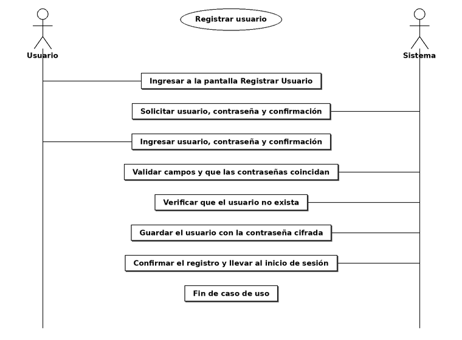
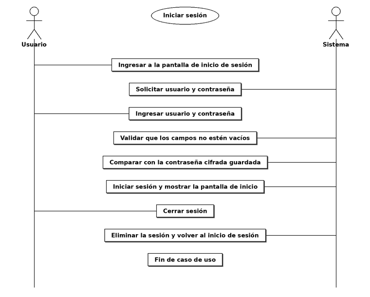

# Casos de uso del módulo de autenticación

Este documento complementa los casos de uso del proyecto **Tienda Nueva** (CU01 a CU13, Fase 1 – Guía 2). Casi todos
ellos tienen como precondición "El usuario debe estar autenticado"; los dos casos de uso que siguen describen cómo se
cumple esa precondición. Mantienen la plantilla, el estilo de diagrama y la numeración del proyecto: **CU14** y **CU15**.

## CU14. Registrar usuario

| Campo              | Descripción                                                                                                                                                                                                                                                                                                                                                                                                                                                                                                                                                                                 |
| ------------------ | ------------------------------------------------------------------------------------------------------------------------------------------------------------------------------------------------------------------------------------------------------------------------------------------------------------------------------------------------------------------------------------------------------------------------------------------------------------------------------------------------------------------------------------------------------------------------------------------- |
| Nombre             | Registrar usuario RF14                                                                                                                                                                                                                                                                                                                                                                                                                                                                                                                                                                      |
| Id del caso de uso | CU14                                                                                                                                                                                                                                                                                                                                                                                                                                                                                                                                                                                        |
| Fecha              | 22/11/2026                                                                                                                                                                                                                                                                                                                                                                                                                                                                                                                                                                                  |
| Descripción        | Este caso de uso permite a una persona crear una cuenta de acceso al sistema ingresando un nombre de usuario y una contraseña.                                                                                                                                                                                                                                                                                                                                                                                                                                                              |
| Actores            | Actor 1: Usuario. Actor 2: Sistema de autenticación.                                                                                                                                                                                                                                                                                                                                                                                                                                                                                                                                     |
| Precondiciones     | El servicio web y la base de datos deben estar en funcionamiento. El usuario debe acceder a la pantalla Registrar Usuario.                                                                                                                                                                                                                                                                                                                                                                                                                                                               |
| Poscondiciones     | Se crea el usuario en la base de datos con su contraseña cifrada. El sistema lleva al usuario al inicio de sesión mostrando el mensaje de registro exitoso.                                                                                                                                                                                                                                                                                                                                                                                                                              |
| Flujo normal       | 1. El usuario ingresa a la pantalla Registrar Usuario. 2. El sistema solicita usuario, contraseña y confirmación de la contraseña. 3. El usuario ingresa los datos y pulsa Registrar Usuario. 4. El sistema valida que los campos no estén vacíos y que las contraseñas coincidan. 5. El sistema verifica que el usuario no exista. 6. El sistema guarda el usuario con la contraseña cifrada. 7. El sistema confirma el registro y lleva al usuario al inicio de sesión.                                                                                                 |
| Flujo alternativo  | **Campos vacíos.** En el paso 4, si falta el usuario o la contraseña, el sistema muestra "Usuario y contraseña son obligatorios" y vuelve al paso 3. **Contraseñas distintas.** En el paso 4, si la confirmación no coincide, el sistema muestra "Las contraseñas no coinciden" y vuelve al paso 3. **Usuario ya registrado.** En el paso 5, si el usuario ya existe, el sistema muestra "El usuario ya existe" y vuelve al paso 3. **Servicio no disponible.** Si el servicio web no responde, el sistema muestra "No se pudo conectar con el servidor" y el caso de uso termina. |

## CU15. Iniciar sesión

| Campo              | Descripción                                                                                                                                                                                                                                                                                                                                                                                                                                                                                                                                                                                                                                                                                                                              |
| ------------------ | ---------------------------------------------------------------------------------------------------------------------------------------------------------------------------------------------------------------------------------------------------------------------------------------------------------------------------------------------------------------------------------------------------------------------------------------------------------------------------------------------------------------------------------------------------------------------------------------------------------------------------------------------------------------------------------------------------------------------------------------- |
| Nombre             | Iniciar sesión RF15                                                                                                                                                                                                                                                                                                                                                                                                                                                                                                                                                                                                                                                                                                                      |
| Id del caso de uso | CU15                                                                                                                                                                                                                                                                                                                                                                                                                                                                                                                                                                                                                                                                                                                                     |
| Fecha              | 22/11/2026                                                                                                                                                                                                                                                                                                                                                                                                                                                                                                                                                                                                                                                                                                                               |
| Descripción        | Este caso de uso permite a un usuario registrado ingresar al sistema validando su usuario y su contraseña, y cerrar su sesión cuando termine. Es la precondición "El usuario debe estar autenticado" de los casos de uso CU01 a CU13.                                                                                                                                                                                                                                                                                                                                                                                                                                                                                                    |
| Actores            | Actor 1: Usuario. Actor 2: Sistema de autenticación.                                                                                                                                                                                                                                                                                                                                                                                                                                                                                                                                                                                                                                                                                  |
| Precondiciones     | El usuario debe estar registrado (CU14). El servicio web y la base de datos deben estar en funcionamiento.                                                                                                                                                                                                                                                                                                                                                                                                                                                                                                                                                                                                                            |
| Poscondiciones     | El usuario accede a la pantalla de inicio y su sesión queda activa en el navegador. Al cerrar sesión, la sesión se elimina y el sistema vuelve a la pantalla de inicio de sesión.                                                                                                                                                                                                                                                                                                                                                                                                                                                                                                                                                     |
| Flujo normal       | 1. El usuario ingresa a la pantalla de inicio de sesión. 2. El sistema solicita usuario y contraseña. 3. El usuario ingresa los datos y pulsa Iniciar Sesión. 4. El sistema valida que los campos no estén vacíos. 5. El sistema compara la contraseña con la contraseña cifrada guardada. 6. El sistema inicia la sesión y muestra la pantalla de inicio con el nombre del usuario. 7. El usuario pulsa Cerrar Sesión. 8. El sistema elimina la sesión y vuelve a la pantalla de inicio de sesión.                                                                                                                                                                                                                 |
| Flujo alternativo  | **Campos vacíos.** En el paso 4, si falta el usuario o la contraseña, el sistema muestra "Usuario y contraseña son obligatorios" y vuelve al paso 3. **Credenciales incorrectas.** En el paso 5, si el usuario no existe o la contraseña no coincide, el sistema muestra "Error en la autenticación", no da acceso y vuelve al paso 3. El mensaje es el mismo en ambos casos para no dar pistas sobre cuál dato falló. **Servicio no disponible.** Si el servicio web no responde, el sistema muestra "No se pudo conectar con el servidor" y el caso de uso termina. **Acceso sin sesión.** Si alguien intenta abrir directamente la pantalla de inicio sin haber iniciado sesión, el sistema lo redirige al inicio de sesión. |
