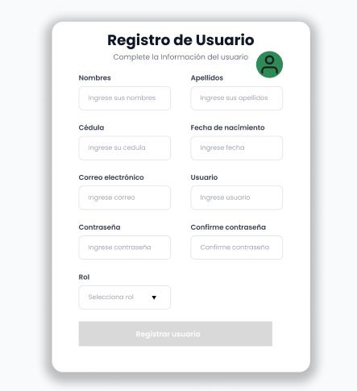
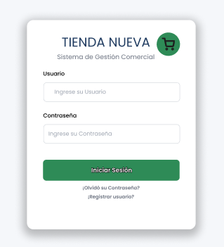
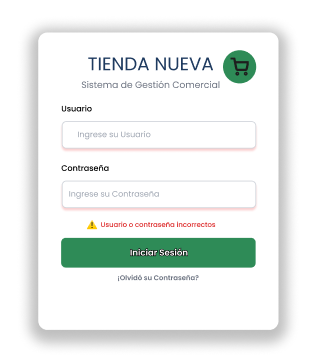

# Trazabilidad de artefactos

Este módulo es la **autenticación básica de Tienda Nueva**: el registro de usuarios y el inicio de sesión, construidos
con React sobre el servicio web de la evidencia AA5-EV01 (`prueba_node_ADSO`). Su codificación parte de los artefactos
que ya se habían elaborado para el proyecto. Este documento muestra de dónde sale cada decisión y en qué parte del
código quedó.

## 1. Artefactos de referencia del proyecto

| Artefacto                  | Documento del proyecto                                        | Qué aporta a este módulo                                                                                      |
| -------------------------- | ------------------------------------------------------------- | ------------------------------------------------------------------------------------------------------------- |
| Requerimientos             | Requerimientos funcionales y no funcionales (Fase 1 – Guía 2) | RNF01 (cifrar datos) y RNF03 (roles de usuario).                                                              |
| Historias de usuario       | Historias de usuario (Fase 1 – Guía 2)                        | HU01 a HU12 son de negocio. Se agregaron HU13 y HU14: ver [historias-de-usuario.md](historias-de-usuario.md). |
| Casos de uso               | Casos de uso (Fase 1 – Guía 2)                                | CU01 a CU13 exigen "usuario autenticado". Se agregaron CU14 y CU15: ver [casos-de-uso.md](casos-de-uso.md).   |
| Diagrama de clases         | Diagrama de clases (Fase 2 – Guía 4)                          | Clase `Usuario` (idUsuario, nombre, correo, contraseña, rol, estado).                                         |
| Modelo conceptual y lógico | Modelo conceptual y lógico del proyecto (Fase 2 – Guía 4)     | Tabla de usuarios (id_usuario, nombre, correo, contraseña, rol).                                              |
| Mapa de navegación         | Interfaz gráfica y mapa de navegación (Fase 2 – Guía 5)       | La navegación inicia en el inicio de sesión y, al validar, lleva a la pantalla principal.                     |
| Prototipo                  | Prototipo con navegación en Figma (Fase 3 – Guía 6)           | Pantallas de registro, inicio de sesión y error de inicio de sesión.                                          |
| Componentes front-end      | Documento AA4-EV02                                            | Componentes `Encabezado`, `FormularioRegistro` y `RutaProtegida`.                                             |

## 2. Del artefacto al código

| Artefacto                                        | Dónde quedó implementado                                                                                                                                                                                                          |
| ------------------------------------------------ | --------------------------------------------------------------------------------------------------------------------------------------------------------------------------------------------------------------------------------- |
| HU13, RF14, CU14 (registrar usuario)             | [`FormularioRegistro.jsx`](../src/componentes/FormularioRegistro.jsx) y `registrarUsuario` en [`authServicio.js`](../src/servicios/authServicio.js), que llama a `POST /api/register`.                                            |
| HU14, RF15, CU15 (iniciar sesión)                | [`FormularioLogin.jsx`](../src/componentes/FormularioLogin.jsx), `iniciarSesion` en [`authServicio.js`](../src/servicios/authServicio.js) y [`sesionServicio.js`](../src/servicios/sesionServicio.js). Llama a `POST /api/login`. |
| Prototipo: Registro de usuario                   | Ruta `/registro`: [`PaginaRegistro.jsx`](../src/paginas/PaginaRegistro.jsx).                                                                                                                                                      |
| Prototipo: Inicio de sesión                      | Ruta `/login`: [`PaginaLogin.jsx`](../src/paginas/PaginaLogin.jsx).                                                                                                                                                               |
| Prototipo: Error de inicio de sesión             | Cuadro de error del componente [`Mensaje.jsx`](../src/componentes/Mensaje.jsx), dentro del mismo formulario.                                                                                                                      |
| Mapa de navegación: pantalla principal           | Ruta `/inicio`: [`PaginaInicio.jsx`](../src/paginas/PaginaInicio.jsx), con [`Encabezado.jsx`](../src/componentes/Encabezado.jsx) y el botón Cerrar Sesión.                                                                        |
| Precondición "usuario autenticado" (CU01 a CU13) | [`RutaProtegida.jsx`](../src/componentes/RutaProtegida.jsx): sin sesión, redirige al inicio de sesión.                                                                                                                            |
| RNF01 (cifrado)                                  | El servicio web guarda la contraseña cifrada con bcrypt.                                                                                                                                                                          |
| Clase `Usuario` y modelo lógico                  | Tabla `usuarios` del servicio web (id, usuario, contraseña cifrada).                                                                                                                                                              |

## 3. Alcance y diferencias con el prototipo

Para no modificar el servicio web ya entregado en la evidencia AA5-EV01, este módulo implementa **solo lo que ese
servicio soporta**. Las diferencias con el prototipo son estas:

| Prototipo de Tienda Nueva                                                  | En este módulo                                           | Motivo                                                                                                                                      |
| -------------------------------------------------------------------------- | -------------------------------------------------------- | ------------------------------------------------------------------------------------------------------------------------------------------- |
| Registro con nombres, apellidos, cédula, fecha de nacimiento, correo y rol | Solo usuario, contraseña y confirmación de la contraseña | El servicio web reutilizado guarda únicamente usuario y contraseña. Los demás campos pertenecen al módulo completo de usuarios del sistema. |
| Enlace "¿Olvidó su contraseña?"                                            | No se incluye                                            | El servicio web no tiene recuperación de contraseña.                                                                                        |
| Roles y permisos por rol (RNF03)                                           | No se incluyen                                           | El servicio web no maneja roles.                                                                                                            |
| Pantalla separada de error de inicio de sesión                             | Cuadro de error dentro del mismo formulario              | Es la solución que ya usa el inicio de sesión implementado en Tienda Nueva.                                                                 |
| Dashboard principal                                                        | Pantalla de inicio con saludo y botón Cerrar Sesión      | El módulo solo cubre la autenticación.                                                                                                      |
| Sesión validada por el servidor                                            | Sesión guardada en el navegador (`sessionStorage`)       | El servicio web no entrega token. Esta sesión solo controla qué pantallas se muestran y no reemplaza la seguridad del servidor.             |

El aspecto visual (colores, fuente, tarjeta y mensajes) sigue el front-end de Tienda Nueva ya implementado.

## 4. Prototipo de referencia

**Registro de usuario**

**Inicio de sesión**

**Error de inicio de sesión**

